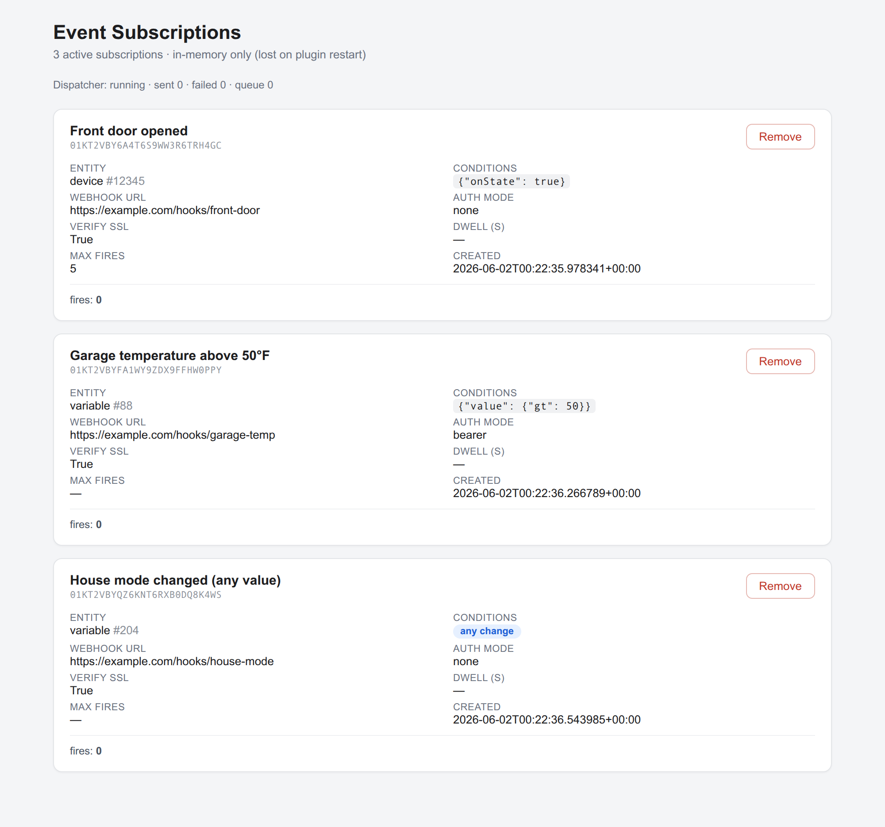

# MCP Advanced Tools for Indigo

> **Beta: 2026.11.0.** This is a beta for **Indigo 2026.1**. It works *alongside* Indigo's built-in
> MCP server, **MCP Control**. On Indigo 2025.2, stay on **MCP Server 2026.10.1**: that release still
> includes the tools this beta removes.

Indigo 2026.1 ships its own Model Context Protocol (MCP) server, MCP Control, which lets an AI assistant
run your home: control devices, set variables, run action groups. It deliberately stops there. It doesn't
look inside your automations or your history, and it only sees what you have published for remote display.

MCP Advanced Tools (formerly the **MCP Server** plugin) is the companion that covers the rest. Connect
both servers to your AI client (see
[Use it with Indigo MCP Control](#use-it-with-indigo-mcp-control)):

- **Search everything**: natural-language search across devices, variables, action groups, triggers and
  schedules, including the ones not published for remote display.
- **See inside automations**: every action step and condition tree of a trigger, schedule or action group,
  plus reverse references ("what could turn this light on?").
- **Investigate**: "what caused this?" for a device change, and full historical event-log search.
- **History** comes from the Grafana Home Dashboard plugin: its `influxlog_query_history` tool is listed
  here as a [plugin-provided tool](#plugin-provided-tools-v202681) while that plugin is installed.
- **Manage automations**: enable/disable (with timed auto-revert), duplicate, move, delete, and edit
  names, descriptions and trigger event settings.
- **Event webhooks**: outbound push notifications when device or variable conditions match.
- **Plugin-provided tools**: tools that other Indigo plugins contribute.

Example questions:

- "Find all light switches in the bedroom"
- "What trigger turned off the porch light last night?"
- "What could change the hallway thermostat?"
- "Disable the motion trigger for two hours"

## What's new in 2026.11.0 (beta)

- **New name:** the MCP Server plugin is now **MCP Advanced Tools**. Existing installs upgrade in place:
  same plugin id, endpoint, device, settings and plugin-provided tools.
- **Works with Indigo MCP Control:** device control, variables, running action groups, triggers and
  schedules, and plain listings and lookups moved to MCP Control, Indigo 2026.1's built-in MCP server
  ([details](#moved-to-mcp-control-in-this-release)). A call to a removed tool name gets an error
  naming its replacement.
- **History moved** to the Grafana Home Dashboard plugin's `influxlog_query_history` tool
  ([details](#moved-to-another-plugin)). The InfluxDB settings are gone from this plugin.
- **Requires Indigo 2026.1.** On Indigo 2025.2, stay on MCP Server 2026.10.1.

## Requirements

- **Indigo Domotics** 2026.1 or later (plugin API 3.9; ships Python 3.13). On Indigo 2025.2, stay on MCP
  Server 2026.10.1.
- **Apple Silicon** (M-series) only: LanceDB 0.30+ no longer ships Intel Mac wheels.
- **OpenAI API key** for semantic search ([get one](https://platform.openai.com/api-keys)). Only device
  names, types, and descriptions are sent, to generate embeddings (minimal cost). See
  [Privacy & Security](#privacy--security).
- **Node.js** (for Claude Desktop only, which connects via `npx mcp-remote`): `brew install node`

## Installation

1. Install the **MCP Advanced Tools** plugin in Indigo via the Plugin Manager.
2. Enter your **OpenAI API key** in the plugin's preferences.
3. Add a new **MCP Advanced Tools** device in Indigo (this creates the actual server; one per install).
4. Wait for the plugin to **index your database** — the first run takes a minute or two (longer for
   very large databases). The index rebuilds itself the same way after an upgrade that changes it.
5. **Connect an MCP client** — see below.

Optional integrations, all off by default:

- **Event Webhooks** — real-time outbound push notifications; requires a server you run, **not** stock
  Claude Desktop. See [Event Subscriptions & Webhooks](#event-subscriptions--webhooks). *(v2026.1.0)*
- **LangSmith** — AI prompt tracing for debugging; most people don't need it.

The **Model** setting (default `gpt-6-luna`) picks the OpenAI model the plugin uses for its own small
jobs: search keywords and search query expansion. Search embeddings always use
`text-embedding-3-large`.

## Connecting an MCP Client

### 1. Get an API key

Every connection authenticates with an Indigo API key sent as `Authorization: Bearer <key>`. Two kinds:

- **Reflector API key** — from your Indigo Reflector settings. Use for remote/HTTPS access.
- **Local secret** — for local/LAN access. Add one to
  `/Library/Application Support/Perceptive Automation/Indigo <VERSION>/Preferences/secrets.json`
  ([format](https://wiki.indigodomo.com/doku.php?id=indigo_2024.2_documentation:indigo_web_server#local_secrets)),
  then restart the Indigo Web Server.

### 2. Pick your endpoint URL

The endpoint path is always `/message/com.vtmikel.mcp_server/mcp/`. Choose the base by where you connect
from (default Web Server port is `8176`):

| Access | Endpoint URL | Key |
|--------|--------------|-----|
| Same machine as Indigo | `http://localhost:8176/message/com.vtmikel.mcp_server/mcp/` | Local secret |
| Another machine on your LAN | `http://<indigo-ip>:8176/message/com.vtmikel.mcp_server/mcp/` | Local secret |
| Remote (outside your network) | `https://<your-reflector>.indigodomo.net/message/com.vtmikel.mcp_server/mcp/` | Reflector key |

For HTTPS on the LAN with a self-signed certificate, use the `https://<indigo-host>:8176/...` URL and see
the self-signed note in the client examples below.

### 3. Configure your client

**VS Code, Cursor, Claude Code** support direct HTTP transport — simpler and more reliable. Add to your MCP
settings (`.vscode/mcp.json`, Cursor MCP settings, or `~/.claude.json` / project `.mcp.json`):

```json
{
  "mcpServers": {
    "indigo-advanced-tools": {
      "type": "http",
      "url": "http://localhost:8176/message/com.vtmikel.mcp_server/mcp/",
      "headers": { "Authorization": "Bearer YOUR_API_KEY" }
    }
  }
}
```

Swap the `url` for the LAN or Reflector variant from the table above.

**Claude Desktop** does not support direct HTTP, so it proxies through `mcp-remote`. Add to
`~/Library/Application Support/Claude/claude_desktop_config.json`:

```json
{
  "mcpServers": {
    "indigo-advanced-tools": {
      "command": "npx",
      "args": [
        "-y", "mcp-remote",
        "https://your-reflector.indigodomo.net/message/com.vtmikel.mcp_server/mcp/",
        "--header", "Authorization:Bearer YOUR_API_KEY"
      ]
    }
  }
}
```

- **Plain HTTP** (local/LAN): add `"--allow-http"` to `args`.
- **Self-signed HTTPS** (LAN): add `"env": { "NODE_TLS_REJECT_UNAUTHORIZED": "0" }` to the server block.

> **Why the difference?** `mcp-remote` requests OAuth endpoints that Indigo doesn't implement; direct HTTP
> transport avoids that entirely, so prefer it whenever your client supports it.

### HTTP transport notes

The endpoint uses the MCP streamable-HTTP transport over the Indigo Web Server: `POST` carries all
messages and `GET` returns `405` (no server→client SSE stream).

**Supported protocol revisions** (both served concurrently on the same endpoint):

| Revision | Style | Notes |
|----------|-------|-------|
| `2026-07-28` | Stateless ("modern") | Per-request `_meta` metadata, `MCP-Protocol-Version` / `Mcp-Method` / `Mcp-Name` headers, `server/discover`. No sessions. |
| `2025-11-25`, `2025-06-18` | Session-based ("legacy") | `initialize` handshake + `Mcp-Session-Id` header; sessions expire after 2 hours idle (current Indigo Web Server versions reject the `DELETE` teardown before it reaches the plugin). **Deprecated** — legacy support will be removed in a future release once MCP clients have migrated to `2026-07-28`. |

A request carrying the modern per-request metadata is served statelessly; an `initialize` request
selects the legacy session flow. Server-push features (`subscriptions/listen`, `listChanged`
notifications) are not offered — Indigo Web Server plugin responses are one-shot, so there is no
SSE channel to deliver them on. `Origin`-header validation is likewise not enforced: the Indigo Web
Server authenticates every request before the plugin sees it, which already defeats DNS rebinding.

## Use it with Indigo MCP Control

Connect **both** servers to your AI client. Both are served by the Indigo Web Server and accept the same
Indigo API key or local secret:

| Server | Endpoint path | Use it for |
|--------|---------------|------------|
| **Indigo MCP Control** (built into Indigo 2026.1) | `/v3/api/mcp` | controlling devices, setting and creating variables, running action groups, triggers and schedules now, listing and looking up objects, plugin status and restarts |
| **This plugin** | `/message/com.vtmikel.mcp_server/mcp/` | search, automation internals and editing, investigation and event-log history, webhooks, plugin-provided tools |

For a client with direct HTTP transport (VS Code, Cursor, Claude Code):

```json
{
  "mcpServers": {
    "indigo": {
      "type": "http",
      "url": "http://localhost:8176/v3/api/mcp",
      "headers": { "Authorization": "Bearer YOUR_API_KEY" }
    },
    "indigo-advanced-tools": {
      "type": "http",
      "url": "http://localhost:8176/message/com.vtmikel.mcp_server/mcp/",
      "headers": { "Authorization": "Bearer YOUR_API_KEY" }
    }
  }
}
```

Both paths share one base URL: swap `http://localhost:8176` for the LAN or Reflector base from
[Pick your endpoint URL](#2-pick-your-endpoint-url). Claude Desktop takes two `mcp-remote` entries the same
way.

Good to know:

- **Visibility differs.** MCP Control only sees objects marked for remote display. This plugin's search
  and automation tools see every object, so `search_entities` can find a device that MCP Control can't
  control until you publish it.
- **A few tool names exist on both servers** (`list_triggers`, `list_schedules`, `query_event_log`). Clients
  keep each server's tools separate. This plugin's versions add trigger summaries, next execution times,
  and full historical log search.
- **The plugin tells clients about the split.** Both protocol eras carry server instructions naming MCP
  Control for control. A call to a removed tool name (for example from a cached tool list) gets an error
  that names its MCP Control replacement.

### Moved to MCP Control in this release

| Removed from this plugin | Use in Indigo MCP Control |
|--------------------------|---------------------------|
| `device_turn_on`, `device_turn_off` | `turn_on`, `turn_off` (also `toggle`) |
| `device_set_brightness` | `set_brightness` (also `brighten`, `dim`) |
| `device_set_rgb_color`, `device_set_rgb_percent`, `device_set_hex_color`, `device_set_named_color`, `device_set_white_levels` | `set_color` |
| `thermostat_set_heat_setpoint`, `thermostat_set_cool_setpoint`, `thermostat_set_hvac_mode`, `thermostat_set_fan_mode` | `set_heat_setpoint`, `set_cool_setpoint`, `set_hvac_mode`, `set_fan_mode` |
| `variable_update`, `variable_create` | `update_variable`, `create_variable` |
| `action_execute_group` | `execute_action_group` (then `confirm` with the token it returns) |
| `control_trigger` / `control_schedule` / `control_action_group` with `action: "execute"` | `execute_trigger` / `execute_schedule` / `execute_action_group` (then `confirm`) |
| `list_devices`, `list_variables`, `list_action_groups`, `list_variable_folders` | `list_devices`, `list_variables`, `list_action_groups`, `list_folders` |
| `get_devices_by_type`, `get_devices_by_state`, `get_device_by_id`, `get_variable_by_id`, `get_action_group_by_id` | the same names |
| `list_plugins`, `get_plugin_by_id`, `get_plugin_status`, `restart_plugin` | `list_plugins`, `get_plugin`, `get_plugin_status`, `restart_plugin` |
| MCP resources `indigo://devices`, `indigo://variables`, `indigo://actions`, `indigo://triggers`, `indigo://schedules` | MCP Control's `indigo://` resources |

This plugin no longer publishes MCP resources and no longer advertises the resources capability.

### Moved to another plugin

| Removed from this plugin | Use instead |
|--------------------------|-------------|
| `analyze_historical_data` | `influxlog_query_history` from the Grafana Home Dashboard (InfluxDB logging) plugin, listed on this server as a plugin-provided tool |

The InfluxDB settings are gone from this plugin's configuration; the Grafana Home Dashboard plugin uses
its own InfluxDB connection.

## What's Possible

What this plugin adds on top of Indigo MCP Control.

| You want to… | Indigo MCP Control | This plugin |
|--------------|--------------------|-------------|
| Control devices (on/off, dim, color, thermostats, speed controls, sprinklers) | ✓ | — |
| Set or create a variable | ✓ | — |
| Run an action group, trigger or schedule | ✓ (asks for confirmation) | — |
| List and look up objects | ✓ published objects | ~ triggers and schedules (`list_triggers`, `list_schedules`) |
| Find things by meaning ("entryway light" → *Foyer Light*) | ✓ `find_*` (published objects) | ✓ `search_entities` (every object) |
| See an automation's action steps and condition tree | ✗ | ✓ `get_*_details` |
| Ask "what could change this device?" | ✗ | ✓ `find_automation_references` |
| Ask "what caused this?" | ✗ | ✓ `investigate_event` |
| Search the event log | recent lines | ✓ full history, text/regex/type/time filters |
| Query InfluxDB history | ✗ | ✓ with the Grafana Home Dashboard plugin (`influxlog_query_history`) |
| Enable/disable an automation (with timed auto-revert), duplicate, move, delete | ✗ | ✓ `control_*` (delete is *gated*) |
| Edit an automation's name/description or a trigger's event settings | ✗ | ✓ `update_*` |
| Push events to your own webhook | ✗ (resource subscriptions instead) | ✓ `create_event_subscription` |
| Use tools other Indigo plugins provide | ✗ | ✓ plugin-provided tools |

**Legend:** ✓ supported · ~ partial · ✗ not possible · — not this server's job.

- Action steps, conditions, and schedule timing are not editable via MCP. Change those in the Indigo UI.
- To make a variant: duplicate an automation (`control_trigger` / `control_schedule` /
  `control_action_group`, `action: "duplicate"`), then edit the copy.
- **Delete** requires the *Allow AI to delete automations* preference (off by default) and `confirm=true`.

## Available Tools

Fifteen tools, plus three more when event webhooks are enabled, and any plugin-provided tools. Most list
tools paginate with `limit` (default 50, max 500) and `offset`, and return `total_count` / `has_more` for
navigation. `search_entities` returns its 10 best matches unless you pass a larger `limit`.

### Search

- **search_entities**: natural-language search across devices, variables, action groups, triggers, and
  schedules, including those not published for remote display. An exact name ("living room lamp" →
  *Living Room Lamp*) is always the first result; otherwise results rank by both the name and the meaning,
  so other words for the same thing also work ("entryway light" → *Foyer Light*). `device_types` (dimmer,
  relay, sensor, …) filters before ranking, so `limit` really returns that many devices of the type, and
  `state_filter` narrows by state. Above 20 results, devices come back with minimal fields. To act on a
  result, use MCP Control (`turn_on`, `set_brightness`, `update_variable`, `execute_action_group`, …).

### Automation introspection *(v2026.6.0)*

Inspect triggers, schedules, and action groups in full, including the action steps and condition trees
that Indigo's scripting API does not expose (read from the server's database file, refreshed within
minutes of a change).

- **list_triggers**: triggers with a one-line summary of what each watches; filter by name/type/enabled/folder
- **list_schedules**: schedules with **next execution time** and a timing summary
- **get_trigger_details** / **get_schedule_details** / **get_action_group_details**: the full explanation of
  one automation: its event/timing, condition tree (or embedded Python condition script), and every action
  step (device commands, variable writes, nested action groups, embedded Python, plugin actions with config),
  IDs resolved to names
- **find_automation_references**: reverse lookup: which automations watch, act on, set, or condition-read a
  device/variable/action group, including indirect paths through nested action groups, heuristic id/name
  matches inside embedded Python (condition scripts and action scripts), cross-checked against Indigo's own
  dependency graph

### Investigation *(v2026.6.0)*

- **investigate_event**: "what caused this?" Finds a device's state-change in the log, collects the
  automations that fired around it, and ranks candidate causes by structural evidence (does it actually act
  on that device, directly or through action-group chains?) plus temporal proximity.
- **query_event_log**: read the event log, newest first. With no filters it returns the recent tail from
  Indigo's live log; add `query`/`regex`/`types`/`start_time`/`end_time` to scan the full historical daily
  log files instead. Each entry is `{timestamp, type, message}`.

### Automation control *(v2026.6.0)*

- **control_trigger** / **control_schedule** / **control_action_group**: lifecycle actions: `enable`/`disable`
  (with a `duration_seconds` auto-revert: "disable this trigger for 2 hours", or a `delay_seconds` start),
  `duplicate`, `move_to_folder`, `remove_delayed_actions`, and `delete`. (Action groups support
  duplicate/move/delete only.) **Delete** requires `confirm=true` **and** the *Allow AI to delete automations* preference (off by
  default); every other action is always available.
- **update_trigger**: edit a trigger's name/description and its event settings (watched device/variable,
  comparison, value), returning a before/after diff.
- **update_schedule** / **update_action_group**: edit name/description only.

Action steps, conditions, and schedule timing are read-only in Indigo's scripting API. Change those in the
Indigo UI. Since there's no API to author actions from scratch, `duplicate` (via `control_trigger`) followed by
`update_trigger` is the supported way to make a trigger variant.

To run a trigger, schedule or action group, use MCP Control's `execute_trigger`, `execute_schedule` or
`execute_action_group`: each returns a confirmation token that its `confirm` tool redeems.

### Event subscriptions *(v2026.1.0, only when webhooks are enabled)*

- **create_event_subscription**: POST a JSON event to your webhook URL when device/variable conditions match
- **list_event_subscriptions**: active subscriptions with delivery health stats (or one by ID)
- **delete_event_subscription**: delete a subscription (cancels pending dwell timers)

See [Event Subscriptions & Webhooks](#event-subscriptions--webhooks) for the full guide.

## Plugin-Provided Tools *(v2026.8.1)*

Other Indigo plugins can contribute their own MCP tools to this server. A provider plugin
ships a small manifest in its bundle; this server discovers it automatically, lists the
tools to AI clients under the provider's prefix (e.g. `autolights_update_zone` from the
[Auto Lights](https://github.com/mlamoure/indigo-auto-lights) plugin), and forwards calls
to the provider.

- **Which plugins may provide tools**: the plugin config menu "Plugins that may provide
  MCP tools" chooses between **All plugins** (the default, and the behavior of earlier
  releases), **Only the plugins selected below** (an allowlist) and **All plugins except
  those selected below** (a blocklist). The two lists are kept separately, so switching
  the mode never reinterprets a saved selection. Each list shows every installed plugin;
  plugins marked "MCP tools: N" ship tools today, and you can select any plugin so one
  that adds tools later is already covered. An empty allowlist turns off every
  plugin-provided tool. A provider the setting excludes is left out completely: its
  tools are not listed, it never claims its tool prefix, and MCP Advanced Tools never
  calls it; a client that calls one of its tools from a cached tool list is told the provider
  is blocked in the plugin config. Takes effect immediately. Built-in tools are not
  affected.
- **Write gate**: the plugin config checkbox "Allow plugin-provided tools to make changes"
  (default on) controls whether provider *write* tools work; read tools always do. It
  applies to the providers the setting above allows. Takes effect immediately.
- **Refresh**: provider tools register automatically when the provider starts or updates.
  A provider installed for the first time while MCP Advanced Tools is running appears on the
  client's next `tools/list` (at most a minute later). The menu item **Plugins → MCP
  Advanced Tools → Rescan Plugin-Provided MCP Tools** forces a re-discovery.
- **Client cache caveat**: `tools/list` responses carry a 1-hour cache hint, so an
  already-connected MCP client may not see newly installed provider tools until it starts
  a fresh session.

### Add MCP tools to your plugin

Three steps — full details and rules in
[docs/mcp-provider-manifest.md](docs/mcp-provider-manifest.md):

**1. Ship a manifest** at `Contents/Resources/mcp-manifest.json` describing your tools:

```json
{
  "manifest_version": 1,
  "provider": {"plugin_id": "com.example.myplugin", "display_name": "My Plugin"},
  "tools": [
    {
      "name": "get_status",
      "description": "Return the plugin's current status.",
      "write": false,
      "inputSchema": {"type": "object", "properties": {}, "required": []}
    }
  ]
}
```

**2. Answer tool calls** — declare a hidden action in `Actions.xml`:

```xml
<Action id="mcp_tool_invoke" uiPath="hidden">
    <Name>MCP Tool Invocation Endpoint</Name>
    <CallbackMethod>handle_mcp_tool_invoke</CallbackMethod>
</Action>
```

and implement the callback in `plugin.py` (arguments arrive as a JSON string; reply with a
JSON-string envelope):

```python
def handle_mcp_tool_invoke(self, action, dev=None, caller_waiting_for_result=True):
    import json
    tool = action.props.get("tool", "")
    args = json.loads(action.props.get("arguments", "{}"))
    if tool == "get_status":
        return json.dumps({"status": "ok", "result": {"state": "running"}})
    return json.dumps({"status": "error",
                       "error": {"type": "not_found", "message": f"unknown tool {tool}"}})
```

**3. Announce yourself** (recommended) — one line in your `startup()` so your tools
register the moment your plugin starts, without restarting MCP Advanced Tools:

```python
try:
    indigo.server.broadcastToSubscribers("mcp_tools_updated")
except Exception:
    pass
```

Your plugin stays fully functional for users who don't have MCP Advanced Tools installed — the
manifest is inert data, the hidden action is never called, and the broadcast is a no-op.

## Event Subscriptions & Webhooks

*Added in v2026.1.0.* Event subscriptions let an MCP client ask Indigo to notify it the next time something
happens — "the next time the front door opens", "if the temperature goes above 80°F", "if the garage door
stays open for 10 minutes".

> ### ⚠️ This is an *outbound* webhook — you must run your own server
>
> When a subscription's conditions match, the plugin sends an **HTTP POST** to a URL **you provide**. It is a
> **sender only** — there is no built-in receiver. **This will not work with stock Claude Desktop** or most
> off-the-shelf MCP clients, which have no way to receive a proactive notification. It's meant for custom
> agents / automation systems that own a persistent HTTP endpoint (for example, [OpenClaw](https://openclaw.ai/)).

Enable it under **Plugins → MCP Advanced Tools → Configure → Enable Event Webhooks** (the three tools are hidden
until then).

### Creating a subscription

`create_event_subscription` accepts:

| Parameter | Type | Required | Description |
|-----------|------|----------|-------------|
| `webhook_url` | string | **yes** | HTTP(S) endpoint **you run** that events are POSTed to. |
| `entity_type` | `"device"` \| `"variable"` | **yes** | What kind of entity to watch. |
| `conditions` | object | **yes** | State conditions that trigger the webhook (see operators below). |
| `entity_id` | integer | no | A specific device/variable ID, or omit to watch **all** entities of that type. |
| `auth` | object | no | `{ "mode": "none"\|"bearer"\|"hmac", "token": "…", "verify_ssl": true }` (see Authentication). |
| `duration_seconds` | integer (≥1) | no | **Dwell time** — the condition must stay matched this long before firing. If it reverts first, nothing is sent. |
| `max_fires` | integer (≥1) | no | Auto-delete the subscription after this many successful deliveries. Use `1` for a one-shot notification. Omit for unlimited. |
| `description` | string | no | Human-readable label for the subscription. |

A webhook fires on the **transition into** a matching state (not repeatedly while it stays matched). Multiple
conditions are combined with **AND**.

```python
# Notify me once, the next time the front door opens
create_event_subscription(
    webhook_url="https://my-server.example.com/indigo-hook",
    entity_type="device", entity_id=12345,
    conditions={"onState": True}, max_fires=1,
    description="Front door opened",
)

# Alert me if the garage door stays open for 10 minutes
create_event_subscription(
    webhook_url="https://my-server.example.com/indigo-hook",
    entity_type="device", entity_id=67890,
    conditions={"onState": True}, duration_seconds=600,
    description="Garage left open",
)
```

### Condition operators

Conditions match against device/variable state keys (including third-party plugin states). Use simple
equality, or an operator object per key:

```jsonc
{ "onState": true }                                    // equality
{ "brightness": { "gt": 50 } }                         // single operator
{ "temperatureInput1": { "gt": 80 }, "onState": true } // AND of multiple keys
```

| Operator | Meaning |
|----------|---------|
| `eq` / `ne` | equal to / not equal to |
| `gt` / `gte` | greater than / greater than or equal |
| `lt` / `lte` | less than / less than or equal |
| `contains` | substring is contained in the value |
| `regex` | value matches the regular expression |

**Variables** match on their `value` key. Indigo stores every value as a **string**, but booleans and
numbers in your conditions are coerced automatically, so `{ "value": true }`, `{ "value": { "eq": "open" } }`,
and `{ "value": { "gt": 50 } }` all work. To fire on *every* change regardless of the new value, use
`{ "any_change": true }` — variables only, and not combinable with `duration_seconds`.

### Authentication

Set via the `auth` parameter; your receiver should validate it so only your Indigo server can post to your
endpoint.

- **`none`** (default) — no auth headers.
- **`bearer`** — adds `Authorization: Bearer <token>`.
- **`hmac`** — adds `X-Webhook-Signature: sha256=<hexdigest>` (`HMAC-SHA256(token, raw_body_bytes)`) and
  `X-Webhook-Timestamp: <unix-seconds>`. Verify on the receiver:

  ```python
  import hmac, hashlib
  expected = "sha256=" + hmac.new(SECRET.encode(), raw_body, hashlib.sha256).hexdigest()
  ok = hmac.compare_digest(expected, request.headers["X-Webhook-Signature"])
  ```

Set `"verify_ssl": false` only if your receiver uses a self-signed certificate.

### The webhook payload

Each delivery is a `POST` with `Content-Type: application/json`, the headers `X-Event-Id`, `X-Event-Type`
(`device.state_changed` | `variable.value_changed`), and `X-Subscription-Id` (plus any auth headers), and a
body like:

```json
{
  "event_id": "01ARZ3NDEKTSV4RRFFQ69G5FAV",
  "schema_version": "1.0",
  "dedupe_key": "indigo:device:12345:state:onState:True",
  "source": { "system": "indigo", "plugin": "com.vtmikel.mcp_server", "host": "my-indigo-mac" },
  "timestamp": "2026-06-01T15:30:45.123456+00:00",
  "event_type": "device.state_changed",
  "entity": { "kind": "device", "id": 12345, "name": "Front Door", "device_type": "…" },
  "state": { "changed_keys": ["onState"], "old": { "onState": false }, "new": { "onState": true } },
  "trigger": { "subscription_id": "…", "conditions_matched": { "onState": true } },
  "human": { "title": "Front Door state changed", "summary": "Front Door: onState=true" }
}
```

Variable changes use `event_type: "variable.value_changed"`, `entity.kind: "variable"`, and a `state` of
`{ "changed_keys": ["value"], "old": { "value": "…" }, "new": { "value": "…" } }`.

### Delivery behavior

- **At-least-once** — retries mean an event can arrive more than once; your receiver **must deduplicate by
  `event_id`** (or `dedupe_key`).
- **Retries** — up to 4 attempts (1 + 3 retries), 10s timeout each, exponential backoff (~1s/2s/4s), on `5xx`
  and network errors. A `4xx` is a permanent rejection and is not retried. Success is any `2xx` — return
  `200` promptly.
- **Persisted across restarts** — subscriptions are saved (`0600`) to
  `…/Preferences/Plugins/com.vtmikel.mcp_server/subscriptions.json` and reloaded on startup, so they survive
  restarts and upgrades. The file **contains your webhook auth tokens** (required so authenticated webhooks
  can re-authenticate). Pending dwell timers are not persisted — a held condition re-arms on its next
  matching transition.

### Managing subscriptions in a browser *(v2026.3.0)*

When webhooks are enabled, the plugin serves a page that **lists active subscriptions and lets you remove
them** (create/edit stays with the MCP tools; auth tokens are never shown).



- **URL:** `http://<your-indigo-host>:8176/message/com.vtmikel.mcp_server/events_ui/` — served by the Indigo
  Web Server under the **same authentication** as the rest of IWS (open it from a browser logged into Indigo).
- **Plugins → MCP Advanced Tools → Print Event Subscriptions Web UI URL** prints the local/LAN/Reflector URLs to the log.

### Minimal example receiver

Any HTTPS endpoint reachable from your Indigo host works. A dependency-free Python receiver to test with:

```python
from http.server import BaseHTTPRequestHandler, HTTPServer
import json

class Handler(BaseHTTPRequestHandler):
    def do_POST(self):
        body = self.rfile.read(int(self.headers.get("Content-Length", 0)))
        # (Optional) verify X-Webhook-Signature here if using HMAC auth.
        event = json.loads(body)
        # Dedupe by event_id — at-least-once delivery means retries can repeat.
        print(f"{event['event_type']} {event['event_id']}: {event['human']['summary']}")
        self.send_response(200)   # any 2xx = success
        self.end_headers()

HTTPServer(("0.0.0.0", 8888), Handler).serve_forever()
```

## Tips for Better Results

- **Be specific** — include location and device type in queries.
- **Use device Notes** — descriptions in the Notes field are included in the AI's context.
- **State vs. search**: for "what's on?" over published devices, use MCP Control's `get_devices_by_state`;
  `search_entities` (with a `state_filter` if needed) finds anything, published or not.

## Privacy & Security

**Sent to OpenAI** (only to build the search index, which is stored locally on your Indigo server): device
name/description/model/type, variable name/description, action-group name/description, and trigger and
schedule names — sent on install and when entities are added or changed. Search queries are sent too, to
expand and embed them. **Never sent:** device states or values, device addresses, credentials, URLs,
IP/network configuration, or historical/usage data.

**Network** — every MCP connection requires Bearer-token authentication. Local HTTP stays on your LAN; use the
Indigo Reflector for encrypted remote access. For self-signed HTTPS on the LAN, set
`NODE_TLS_REJECT_UNAUTHORIZED=0` (Claude Desktop) as shown above.

## Support

- **Issues:** the project repository
- **Questions:** [Indigo Domotics Forum](https://forums.indigodomo.com/viewforum.php?f=274)
