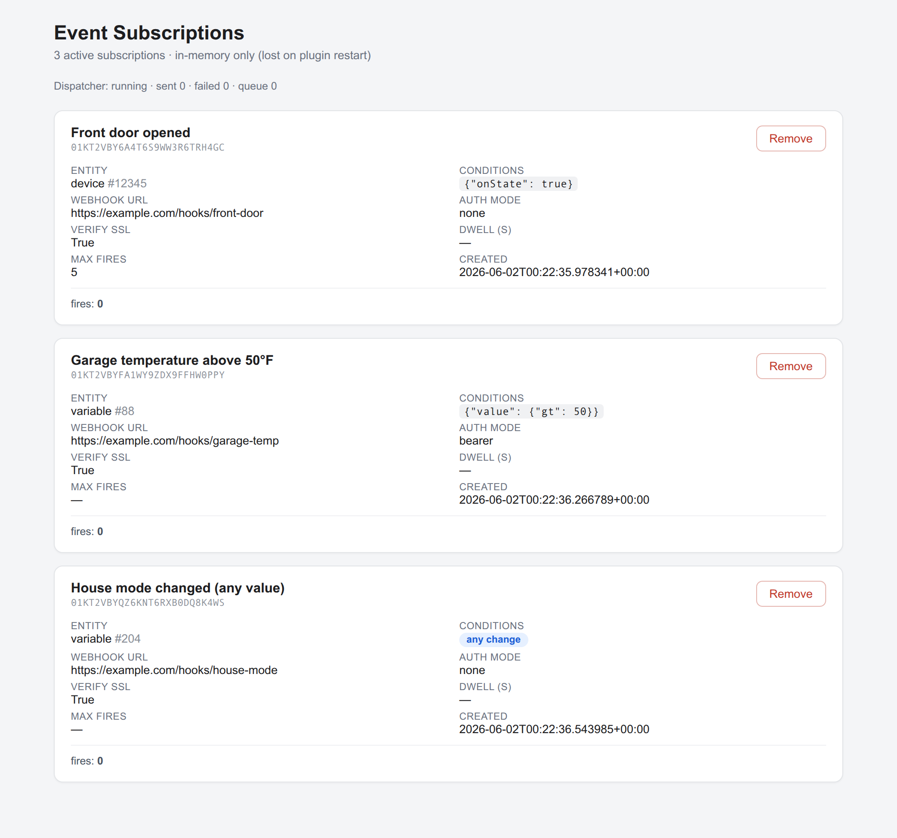

# MCP Advanced Tools for Indigo

Indigo 2026.1 has its own MCP server built in, [MCP Control](https://docs.indigodomo.com/2026.1/user/mcp-control/).
It lets an AI assistant control devices, set variables and run action groups. MCP Advanced Tools is a
second MCP server that runs next to it and covers what MCP Control leaves out:

- **Search everything**: natural-language search across devices, variables, action groups, triggers and
  schedules, including objects not published for remote display.
- **See inside automations**: the action steps and conditions of any trigger, schedule or action group,
  and which automations could change a given device or variable.
- **Investigate**: "what caused this?" for a device change, and search of the full event-log history.
- **Manage automations**: enable or disable (optionally for a set time), duplicate, move, delete, and edit
  names, descriptions and trigger events.
- **Tags**: create, rename, recolor and delete tags, and add or remove them on any object in bulk.
- **Event webhooks**: push a notification to your own server when a device or variable condition matches.
- **Plugin-provided tools**: tools that other Indigo plugins contribute.

Example questions:

- "Find all light switches in the bedroom"
- "What trigger turned off the porch light last night?"
- "What could change the hallway thermostat?"
- "Disable the motion trigger for two hours"
- "Tag every outdoor light and the schedules that run them as `outside`"

## Requirements

- **Indigo** 2026.1 or later. (On Indigo 2025.2, use MCP Server 2026.10.1.)
- **Apple Silicon** Mac.
- **OpenAI API key** for semantic search ([get one](https://platform.openai.com/api-keys)). See
  [Privacy & Security](#privacy--security) for what is sent.
- **Node.js** only for Claude Desktop, which connects through `npx mcp-remote`: `brew install node`.

## Installation

1. Install the **MCP Advanced Tools** plugin in Indigo.
2. Enter your **OpenAI API key** in the plugin's preferences.
3. Create one **MCP Advanced Tools** device. This starts the server.
4. Wait a minute or two while the plugin indexes your database.
5. Connect your AI client (below).

The **Model** preference (default `gpt-6-luna`) is the OpenAI model used to expand search queries.
Embeddings always use `text-embedding-3-large`.

## Connecting a client

Connect your AI client to **both** servers. Both run on the Indigo Web Server and accept the same key.

| Server | Endpoint path | Use it for |
|--------|---------------|------------|
| Indigo MCP Control | `/v3/api/mcp` | controlling devices, variables, running action groups/triggers/schedules, listing objects, plugins |
| MCP Advanced Tools | `/message/com.vtmikel.mcp_server/mcp/` | everything listed above |

**Key.** Send an Indigo API key or a local secret as `Authorization: Bearer <key>`. Create API keys under
[Authorizations in your Indigo Account](https://www.indigodomo.com/account/authorizations); local secrets go
in `Preferences/secrets.json` in your Indigo install folder (see Indigo's
[connection guide](https://docs.indigodomo.com/2026.1/user/mcp-control/connecting/)).

**Base URL.** Put the endpoint path after one of these (default port `8176`):

- Same Mac: `http://localhost:8176`
- Your LAN: `http://<indigo-ip>:8176`
- Remote: `https://<your-reflector>.indigodomo.net`

**VS Code, Cursor, Claude Code** (direct HTTP: `.vscode/mcp.json`, Cursor's MCP settings,
`~/.claude.json` or a project `.mcp.json`):

```json
{
  "mcpServers": {
    "indigo": {
      "type": "http",
      "url": "http://localhost:8176/v3/api/mcp",
      "headers": { "Authorization": "Bearer YOUR_API_KEY" }
    },
    "indigo-advanced-tools": {
      "type": "http",
      "url": "http://localhost:8176/message/com.vtmikel.mcp_server/mcp/",
      "headers": { "Authorization": "Bearer YOUR_API_KEY" }
    }
  }
}
```

**Claude Desktop** has no direct HTTP support, so it goes through `mcp-remote`
(`~/Library/Application Support/Claude/claude_desktop_config.json`). Add one entry per server:

```json
{
  "mcpServers": {
    "indigo-advanced-tools": {
      "command": "npx",
      "args": [
        "-y", "mcp-remote",
        "https://your-reflector.indigodomo.net/message/com.vtmikel.mcp_server/mcp/",
        "--header", "Authorization:Bearer YOUR_API_KEY"
      ]
    }
  }
}
```

For plain HTTP on the LAN, add `"--allow-http"` to `args`. For a self-signed HTTPS certificate, add
`"env": { "NODE_TLS_REJECT_UNAUTHORIZED": "0" }` to the entry.

**Transport.** The endpoint speaks MCP streamable HTTP: `POST` only (`GET` returns `405`), no server push.
It serves protocol `2026-07-28` statelessly and the older session-based `2025-11-25` / `2025-06-18`
(sessions expire after 2 hours idle).

## How the two servers split the work

| You want to… | MCP Control | MCP Advanced Tools |
|--------------|-------------|--------------------|
| Control devices, set or create variables | ✓ | — |
| Run an action group, trigger or schedule | ✓ (with confirmation) | — |
| List and look up objects | ✓ published objects | triggers and schedules |
| Find things by meaning ("entryway light" → *Foyer Light*) | ✓ published objects | ✓ every object |
| See an automation's steps and conditions | ✗ | ✓ |
| "What could change this device?" / "What caused this?" | ✗ | ✓ |
| Search the event log | recent lines | ✓ full history |
| Enable/disable, duplicate, move, delete, rename automations | ✗ | ✓ |
| Read tags | ✓ | ✓ |
| Create, edit, delete and apply tags | ✗ | ✓ |
| Webhooks to your own server | ✗ | ✓ |
| Tools from other plugins | ✗ | ✓ |

- MCP Control only sees objects published for remote display. This plugin sees every object, so it can
  find a device that MCP Control can't control until you publish it.
- `list_triggers`, `list_schedules` and `query_event_log` exist on both servers. This plugin's versions add
  trigger summaries, next run times and full log history.
- Action steps, conditions and schedule timing can't be edited over MCP; change them in Indigo. To make a
  variant of an automation, duplicate it and edit the copy.

## Tools

Seventeen tools, three more when webhooks are on, plus any plugin-provided tools. List tools page with
`limit` (default 50, max 500) and `offset`.

### Search

- **search_entities**: natural-language search across every device, variable, action group, trigger and
  schedule. An exact name match comes first; otherwise results rank by name and meaning. Filter by
  `device_types`, `state_filter` and `tags` (`tag_match`: `all` or `any`). Returns 10 results unless you set
  `limit`.

### Automations

- **list_triggers** / **list_schedules**: one-line summaries (schedules include the next run time); filter by
  name, type, enabled, folder or tags.
- **get_trigger_details** / **get_schedule_details** / **get_action_group_details**: the full automation —
  event or timing, condition tree or condition script, and every action step, with IDs resolved to names.
- **find_automation_references**: which automations watch, act on, set or check a device, variable or action
  group, including through nested action groups and embedded Python.
- **control_trigger** / **control_schedule** / **control_action_group**: `enable` / `disable` (with
  `duration_seconds` to revert automatically, or `delay_seconds` to start later), `duplicate`,
  `move_to_folder`, `remove_delayed_actions`, `delete`. Action groups support duplicate, move and delete.
- **update_trigger**: edit name, description and the trigger's event (device/variable, comparison, value).
- **update_schedule** / **update_action_group**: edit name and description.

To run an automation, use MCP Control's `execute_trigger`, `execute_schedule` or `execute_action_group`.

### Investigation

- **investigate_event**: finds a device's state change in the log and ranks the automations that likely
  caused it.
- **query_event_log**: the event log, newest first. Without filters it reads the live log; with
  `query`, `regex`, `types`, `start_time` or `end_time` it searches the full history.

### Tags

- **manage_tags**: `create` (name and hex color), `update` (rename or recolor), `delete`. Names are
  lowercase words joined by dashes (`holiday-lighting`).
- **tag_objects**: `add` or `remove` one tag on up to 200 objects of any type (`device`, `variable`,
  `trigger`, `schedule`, `action_group`, `control_page`). Each object reports its outcome; `dry_run=true`
  previews.

### Event subscriptions (when webhooks are on)

- **create_event_subscription**, **list_event_subscriptions**, **delete_event_subscription**. See
  [Event webhooks](#event-webhooks).

### Safety settings

| Setting | Default | Effect |
|---------|---------|--------|
| Allow AI to delete automations | off | Required, with `confirm=true`, to delete a trigger, schedule or action group |
| Allow AI to delete tags | off | Required, with `confirm=true`, to delete a tag |
| Confirmation tag | `ask-first` | Automations carrying this tag need `confirm=true` for any change. Empty turns it off |
| Allow plugin-provided tools to make changes | on | Off makes plugin-provided write tools refuse |

Removing a tag from more than 25 objects, or removing or renaming the confirmation tag, also needs
`confirm=true`.

## Plugin-provided tools

Other Indigo plugins can add tools to this server. The plugin finds them automatically and lists them under
the provider's prefix, for example `autolights_update_zone` from
[Auto Lights](https://github.com/mlamoure/indigo-auto-lights).

- **Which plugins**: the preference *Plugins that may provide MCP tools* is **All plugins** (default),
  **Only the plugins selected below**, or **All plugins except those selected below**. An excluded plugin's
  tools are not listed or called.
- **Refresh**: new tools appear within a minute. **Plugins → MCP Advanced Tools → Rescan Plugin-Provided MCP
  Tools** forces it. A connected client may need a new session to see them.

### Add MCP tools to your plugin

Full rules: [docs/mcp-provider-manifest.md](docs/mcp-provider-manifest.md).

1. Ship `Contents/Resources/mcp-manifest.json`:

   ```json
   {
     "manifest_version": 1,
     "provider": {"plugin_id": "com.example.myplugin", "display_name": "My Plugin"},
     "tools": [
       {
         "name": "get_status",
         "description": "Return the plugin's current status.",
         "write": false,
         "inputSchema": {"type": "object", "properties": {}, "required": []}
       }
     ]
   }
   ```

2. Declare a hidden action in `Actions.xml` and handle it in `plugin.py`:

   ```xml
   <Action id="mcp_tool_invoke" uiPath="hidden">
       <Name>MCP Tool Invocation Endpoint</Name>
       <CallbackMethod>handle_mcp_tool_invoke</CallbackMethod>
   </Action>
   ```

   ```python
   def handle_mcp_tool_invoke(self, action, dev=None, caller_waiting_for_result=True):
       import json
       tool = action.props.get("tool", "")
       args = json.loads(action.props.get("arguments", "{}"))
       if tool == "get_status":
           return json.dumps({"status": "ok", "result": {"state": "running"}})
       return json.dumps({"status": "error",
                          "error": {"type": "not_found", "message": f"unknown tool {tool}"}})
   ```

3. Optionally, announce your tools from `startup()` so they register immediately:

   ```python
   try:
       indigo.server.broadcastToSubscribers("mcp_tools_updated")
   except Exception:
       pass
   ```

Your plugin works the same without MCP Advanced Tools installed.

## Event webhooks

An event subscription sends an HTTP POST to **your own server** when a device or variable condition
matches — "the next time the front door opens", "if the garage stays open for 10 minutes".

> The plugin only sends. It does not work with stock Claude Desktop or other clients that can't receive
> a webhook; it is meant for agents and automation systems with their own HTTP endpoint.

Turn it on in **Plugins → MCP Advanced Tools → Configure → Enable Event Webhooks**.

### Creating a subscription

| Parameter | Required | Description |
|-----------|----------|-------------|
| `webhook_url` | yes | Your endpoint |
| `entity_type` | yes | `"device"` or `"variable"` |
| `conditions` | yes | State conditions, combined with AND |
| `entity_id` | no | One device/variable; omit to watch all of that type |
| `auth` | no | `{ "mode": "none"\|"bearer"\|"hmac", "token": "…", "verify_ssl": true }` |
| `duration_seconds` | no | Condition must hold this long before firing |
| `max_fires` | no | Delete after this many deliveries (`1` = one-shot) |
| `description` | no | Label |

A subscription fires when the state *changes into* a match, not repeatedly while it stays matched.

```python
create_event_subscription(
    webhook_url="https://my-server.example.com/indigo-hook",
    entity_type="device", entity_id=67890,
    conditions={"onState": True}, duration_seconds=600,
    description="Garage left open",
)
```

### Conditions

Match any state key, including plugin states, by value or with an operator:

```jsonc
{ "onState": true }
{ "temperatureInput1": { "gt": 80 }, "onState": true }
```

Operators: `eq`, `ne`, `gt`, `gte`, `lt`, `lte`, `contains`, `regex`. Variables match on `value`; booleans and
numbers are compared as such. `{ "any_change": true }` fires on every variable change (not combinable with
`duration_seconds`).

### Authentication

- `bearer`: sends `Authorization: Bearer <token>`.
- `hmac`: sends `X-Webhook-Signature: sha256=<HMAC-SHA256(token, body)>` and `X-Webhook-Timestamp`.

  ```python
  import hmac, hashlib
  expected = "sha256=" + hmac.new(SECRET.encode(), raw_body, hashlib.sha256).hexdigest()
  ok = hmac.compare_digest(expected, request.headers["X-Webhook-Signature"])
  ```

Set `"verify_ssl": false` only for a self-signed receiver.

### Payload

A JSON `POST` with headers `X-Event-Id`, `X-Event-Type` and `X-Subscription-Id`:

```json
{
  "event_id": "01ARZ3NDEKTSV4RRFFQ69G5FAV",
  "schema_version": "1.0",
  "dedupe_key": "indigo:device:12345:state:onState:True",
  "source": { "system": "indigo", "plugin": "com.vtmikel.mcp_server", "host": "my-indigo-mac" },
  "timestamp": "2026-06-01T15:30:45.123456+00:00",
  "event_type": "device.state_changed",
  "entity": { "kind": "device", "id": 12345, "name": "Front Door", "device_type": "…" },
  "state": { "changed_keys": ["onState"], "old": { "onState": false }, "new": { "onState": true } },
  "trigger": { "subscription_id": "…", "conditions_matched": { "onState": true } },
  "human": { "title": "Front Door state changed", "summary": "Front Door: onState=true" }
}
```

Variable events use `event_type: "variable.value_changed"` and `entity.kind: "variable"`.

### Delivery

- **At least once**: deduplicate by `event_id`. Respond with any `2xx`.
- **Retries**: up to 4 attempts with backoff on `5xx` and network errors; a `4xx` is not retried.
- **Persistence**: subscriptions survive restarts. They are stored, with their auth tokens, in
  `…/Preferences/Plugins/com.vtmikel.mcp_server/subscriptions.json` (mode `0600`). A pending
  `duration_seconds` wait does not survive a restart.

### Managing subscriptions in a browser

When webhooks are on, `http://<indigo-host>:8176/message/com.vtmikel.mcp_server/events_ui/` lists active
subscriptions and lets you remove them. It uses normal Indigo Web Server login. **Plugins → MCP Advanced
Tools → Print Event Subscriptions Web UI URL** logs the URLs.



## Tips

- Include the location and device type in a question.
- Device Notes are part of the search index, so good notes improve results.

## Privacy & Security

**Sent to OpenAI** to build the search index (stored on your Indigo Mac): names, descriptions, models and
types of devices, variables, action groups, triggers and schedules, plus your search queries. **Never
sent:** device states or values, addresses, credentials, URLs, network configuration or history.

Every MCP request needs a key. Use the Indigo Reflector for encrypted remote access.

## Support

- **Issues:** the project repository
- **Questions:** [Indigo Domotics Forum](https://forums.indigodomo.com/viewforum.php?f=274)
